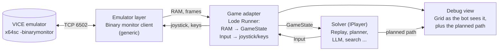

# VICE Lode Runner Auto-Player: Plan

A standalone C# program that plays Commodore 64 games running in the VICE emulator. The first target is **Lode Runner**.

This file records the plan, the decisions made so far and current progress, so work can continue across sessions. Update it whenever a milestone moves forward or a decision changes.

---

## Status

**Current milestone:** M0 (project setup)
**Last updated:** 2026-11-14

---

## Decisions

| # | Decision | Reason |
| --- | ---------- | -------- |
| D1 | Language: C# / .NET | Owner's choice. |
| D2 | Talk to VICE through its **binary monitor protocol** (`x64sc -binarymonitor`, TCP port 6502) | One connection covers memory read/write, joystick and keyboard input, screen grab, snapshots, breakpoints and pause/step/resume. No screen capture or fake keypresses into a window. |
| D3 | Read game state from **C64 RAM**. Template matching on the framebuffer is the fallback. | RAM gives exact data with nothing to misread. C64 output is pixel-exact and Lode Runner tiles sit on a fixed 28×16 grid, so the fallback would also be reliable. |
| D4 | Run the bot **in step with the game**: break once per frame, read state, decide, set input, resume. | Every run can be reproduced exactly, and a slow solver only slows the game down instead of losing it. |
| D5 | Three layers: emulator connection, game adapter, solver (behind an `IPlayer` interface) | The emulator layer can be reused for other games, and each solver idea is just another `IPlayer` implementation. |

## Architecture

- `IPlayer.Decide(GameState) -> Input` (exact shape to be settled in M3/M4).
- A RAM-compare tool (diff memory between frames) is part of the emulator tooling, for finding game data in this game and future ones.

## Milestones

### M0: Project setup

- [x] Create repo and plan document
- [ ] Check which VICE version is installed (binary monitor needs 3.5 or later)
- [ ] Get a Lode Runner image (disk or cartridge) that runs in VICE
- [ ] Choose a .NET version and create the solution skeleton
- [ ] Decide: write our own binary monitor client, or use an existing .NET library (Righthand.ViceMonitor.Bridge, to be checked)

### M1: Connect C# to VICE

- [ ] Connect and ping
- [ ] Read and write memory
- [ ] Pause, step and resume; break once per frame (breakpoint on the main loop or interrupt handler)
- [ ] Set joystick state and send keys
- [ ] Grab the screen
- [ ] Save and load snapshots

### M2: Find Lode Runner's data in RAM

- [ ] Build the RAM-compare tool
- [ ] Level grid (28×16) and tile codes
- [ ] Player position, including position within a tile
- [ ] Guard positions and states
- [ ] Gold remaining, lives, level number
- [ ] Hole/dig state and refill timers
- [ ] Find out how the C64 version maps digging (fire button plus direction, or keys)
- [ ] Record findings in the RAM map below

### M3: Snapshot and replay (solver idea 1)

- [ ] Record inputs per frame while a human plays
- [ ] Replay them from the same snapshot and confirm the result is identical

### M4: Planner for levels without guards (solver idea 2)

- [ ] Model the level as a graph using the movement rules (walk, climb, rope, fall, dig and drop)
- [ ] BFS/A* to each piece of gold, then to the exit ladder
- [ ] Debug view showing the grid and the planned path
- [ ] Use the built-in level editor to make easy test levels

### M5: Guards

- [ ] Avoid guards
- [ ] Trap guards in holes, taking refill timing into account

### M6: Experiments

- [ ] LLM as strategist on top of the planner (latency doesn't matter because the bot controls time)
- [ ] Snapshot search: use the emulator itself as the simulator (try moves, check the result, restore)
- [ ] Reinforcement learning (unlikely to pay off: rewards are rare and the game needs planning)

## Lode Runner RAM map

Fill this in during M2.

| Address | Size | Meaning | Notes |
|---------|------|---------|-------|
|         |      |         |       |

## Open questions

- Which VICE version and which Lode Runner release are we using?
- What UI framework for the debug view (WinForms, WPF, Avalonia)?
- How does the C64 version handle digging input?
- Where do guards respawn, and is it random? (This affects whether replays stay deterministic.)

## Session log

- **2026-11-14:** Talked through the approach (binary monitor, RAM reading, three solver ideas plus snapshot search). Created this plan.
