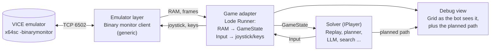

# VICE Lode Runner Auto-Player: Plan

A standalone C# program that plays Commodore 64 games running in the VICE emulator. The first target is **Lode Runner**.

This file records the plan, the decisions made so far and current progress, so work can continue across sessions. Update it whenever a milestone moves forward or a decision changes.

---

## Status

**Current milestone:** M0 (project setup)
**Last updated:** 2026-11-14

---

## Environment

| What | Where | Notes |
| --- | --- | --- |
| VICE 3.10 | `C:\Tools\C64\VICE-3.10` | Use `bin\x64sc.exe` (the cycle-exact C64 emulator). `bin\c1541.exe` lists and extracts disk images. The manual is `doc\vice.pdf`. |
| Lode Runner disk | `C:\Emulation\ROMs\C64\Lode Runner.d64` | A 35-track image from c64hq.com holding several versions. See the disk contents below. |

The disk holds **three versions** of the game (files from `c1541 -list`, load addresses from the file headers):

| Version | Files | What we know |
| --- | --- | --- |
| A | `loderunner+3m/pw` (63 blocks, $0801) | First file on the disk, so `LOAD"*",8,1` (or autostarting the image without a file name) loads this one. Starts with a trainer menu: `UNLIMITED LIVES (Y/N)?`, `TOTAL INVINCIBILITY (Y/N)?`, a note that the C= key skips levels during the game, then press SPACE. Tried 2026-11-14 with Y/Y: the status line is clean. |
| B | `loderunner i` (3 blocks, $0801) + `it` (89 blocks, $6000) + `db` (12 blocks, $1400) | Crack by "M & J", January 1984. `loderunner i` is a BASIC loader: it shows a loading screen ("plug joystick into port #2"), then a small machine-code routine (POKEd into screen memory and hidden by black-on-black colour) loads `it` and `db` and jumps to $6000. So `it` is the main program and `db` is data of some kind. |
| C | `lode runner` (73 blocks, $0801) | Tried first (2026-11-14, `-autostart "...Lode Runner.d64:lode runner"`). Plays fine, but the status line at the bottom has stray white pixels. |

Pick one version and stick with it, because RAM addresses can differ between versions.

## Lode Runner notes

Observations about the game itself, gathered while playing.

- Joystick in **port 2** (according to version B's loading screen).
- Undiggable blocks look different from diggable bricks. On level 1, the left part of the top brick row is undiggable.

## Decisions

| # | Decision | Reason |
| --- | ---------- | -------- |
| D1 | Language: C# / .NET | Owner's choice. |
| D2 | Talk to VICE through its **binary monitor protocol** (`x64sc -binarymonitor`, TCP port 6502) | One connection covers memory read/write, joystick and keyboard input, screen grab, snapshots, breakpoints and pause/step/resume. No screen capture or fake keypresses into a window. |
| D3 | Read game state from **C64 RAM**. Template matching on the framebuffer is the fallback. | RAM gives exact data with nothing to misread. C64 output is pixel-exact and Lode Runner tiles sit on a fixed 28×16 grid, so the fallback would also be reliable. |
| D4 | Run the bot **in step with the game**: break once per frame, read state, decide, set input, resume. | Every run can be reproduced exactly, and a slow solver only slows the game down instead of losing it. |
| D5 | Three layers: emulator connection, game adapter, solver (behind an `IPlayer` interface) | The emulator layer can be reused for other games, and each solver idea is just another `IPlayer` implementation. |
| D6 | Use **version A** (`loderunner+3m/pw`). Use the trainer (invincibility, C= level skip, unlimited lives) during development; the bot's real runs answer N/N. | Clean display, unlike version C. The trainer makes testing much easier: the planner can be tested on real levels without guards killing the player, and any level can be reached quickly. |
| D7 | Target **.NET 10** | The only SDK installed (10.0.402), and the current long-term-support release. |
| D8 | Write **our own binary monitor client** instead of using a third-party library | The protocol is small (a short header plus a command per message, and we need about a dozen commands). No dependency on a library keeping up with VICE versions. Existing libraries can still be read for reference. |

## Architecture

- `IPlayer.Decide(GameState) -> Input` (exact shape to be settled in M3/M4).
- A RAM-compare tool (diff memory between frames) is part of the emulator tooling, for finding game data in this game and future ones.

## Milestones

### M0: Project setup

- [x] Create repo and plan document
- [x] Check which VICE version is installed (binary monitor needs 3.5 or later): VICE 3.10
- [x] Get a Lode Runner image (disk or cartridge): `Lode Runner.d64`, see Environment
- [x] Choose which version on the disk to use: version A (D6)
- [x] Choose a .NET version: .NET 10 (D7)
- [x] Decide: our own binary monitor client or an existing library: our own (D8)
- [ ] Create the solution skeleton (steps below)

#### Solution skeleton

Done one step at a time, checking each step before starting the next. Project names use the prefix `C64Bot` (confirmed in S1). The Lode Runner game library (`C64Bot.LodeRunner`) is added later, in M2, when there is something to put in it.

- [x] **S1. Solution and shared settings.** Create `src/` and `tests/` folders, the solution file `C64Bot.slnx`, a .NET `.gitignore`, and a `Directory.Build.props` that makes every project target `net10.0` with nullable reference types and implicit usings on. Check: `dotnet sln list` runs and shows no projects yet.
- [x] **S2. Emulator library.** Class library `src/C64Bot.Vice`, added to the solution. This is where the binary monitor client will live. Check: `dotnet build` succeeds.
- [x] **S3. Test project.** xUnit project `tests/C64Bot.Vice.Tests`, referencing the emulator library, with one placeholder test. Check: `dotnet test` passes.
- [ ] **S4. Console app.** `src/C64Bot.App`, referencing the emulator library, printing one line. Check: `dotnet run --project src/C64Bot.App` prints it.
- [ ] **S5. Commands in CLAUDE.md.** Add the build, test and run commands so future sessions know them.

### M1: Connect C# to VICE

- [ ] Connect and ping
- [ ] Read and write memory
- [ ] Pause, step and resume; break once per frame (breakpoint on the main loop or interrupt handler)
- [ ] Set joystick state and send keys
- [ ] Grab the screen
- [ ] Save and load snapshots

### M2: Find Lode Runner's data in RAM

- [ ] Build the RAM-compare tool
- [ ] Level grid (28×16) and tile codes
- [ ] Player position, including position within a tile
- [ ] Guard positions and states
- [ ] Gold remaining, lives, level number
- [ ] Hole/dig state and refill timers
- [ ] Find out how the C64 version maps digging (fire button plus direction, or keys)
- [ ] Record findings in the RAM map below

### M3: Snapshot and replay (solver idea 1)

- [ ] Record inputs per frame while a human plays
- [ ] Replay them from the same snapshot and confirm the result is identical

### M4: Planner for levels without guards (solver idea 2)

- [ ] Model the level as a graph using the movement rules (walk, climb, rope, fall, dig and drop)
- [ ] BFS/A* to each piece of gold, then to the exit ladder
- [ ] Debug view showing the grid and the planned path
- [ ] Test on real levels with the trainer's invincibility on, using C= to skip to the level under test

### M5: Guards

- [ ] Avoid guards
- [ ] Trap guards in holes, taking refill timing into account

### M6: Experiments

- [ ] LLM as strategist on top of the planner (latency doesn't matter because the bot controls time)
- [ ] Snapshot search: use the emulator itself as the simulator (try moves, check the result, restore)
- [ ] Reinforcement learning (unlikely to pay off: rewards are rare and the game needs planning)

## Lode Runner RAM map

Fill this in during M2.

| Address | Size | Meaning | Notes |
|---------|------|---------|-------|
|         |      |         |       |

## Open questions

- Does the trainer change any game code or RAM that the bot relies on? Check by comparing RAM with the trainer on and off once the RAM map exists.
- How should the bot get past the trainer menu: type the answers, or always start from a snapshot taken after the menu?
- What UI framework for the debug view (WinForms, WPF, Avalonia)?
- How does the C64 version handle digging input?
- Where do guards respawn, and is it random? (This affects whether replays stay deterministic.)

## Session log

- **2026-11-14:** Talked through the approach (binary monitor, RAM reading, three solver ideas plus snapshot search). Created this plan. Found VICE 3.10 and a Lode Runner disk with three versions on it (A, B, C). Version C runs but has stray white pixels on the status line. Version A has a trainer menu (unlimited lives, invincibility, C= skips levels) and a clean status line, so we chose version A (D6). Chose .NET 10 (D7) and our own binary monitor client (D8). Planned the solution skeleton as steps S1–S5. Next: S1.
