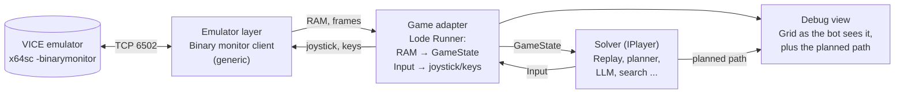

# VICE Lode Runner Auto-Player: Plan

A standalone C# program that plays Commodore 64 games running in the VICE emulator. The first target is **Lode Runner**.

This is the overview: status, decisions, architecture, milestones, open questions and session log. Each milestone that has started has its own document in [milestones/](milestones/) with its steps and notes. Facts about the game live in [lode-runner.md](lode-runner.md).

---

## Status

**Current milestone:** M1 (connect C# to VICE), see [M1-connect-to-vice.md](milestones/M1-connect-to-vice.md)
**Last updated:** 2026-11-14

---

## Environment

| What | Where | Notes |
| --- | --- | --- |
| VICE 3.10 | `C:\Tools\C64\VICE-3.10` | Use `bin\x64sc.exe` (the cycle-exact C64 emulator). `bin\c1541.exe` lists and extracts disk images. The manual is `doc\vice.pdf`. |
| Lode Runner disk | `C:\Emulation\ROMs\C64\Lode Runner.d64` | Holds three versions of the game; we use version A. See [lode-runner.md](lode-runner.md). |

## Decisions

| # | Decision | Reason |
| --- | ---------- | -------- |
| D1 | Language: C# / .NET | Owner's choice. |
| D2 | Talk to VICE through its **binary monitor protocol** (`x64sc -binarymonitor`, TCP port 6502) | One connection covers memory read/write, joystick and keyboard input, screen grab, snapshots, breakpoints and pause/step/resume. No screen capture or fake keypresses into a window. |
| D3 | Read game state from **C64 RAM**. Template matching on the framebuffer is the fallback. | RAM gives exact data with nothing to misread. C64 output is pixel-exact and Lode Runner tiles sit on a fixed 28×16 grid, so the fallback would also be reliable. |
| D4 | Run the bot **in step with the game**: break once per frame, read state, decide, set input, resume. | Every run can be reproduced exactly, and a slow solver only slows the game down instead of losing it. |
| D5 | Three layers: emulator connection, game adapter, solver (behind an `IPlayer` interface) | The emulator layer can be reused for other games, and each solver idea is just another `IPlayer` implementation. |
| D6 | Use **version A** (`loderunner+3m/pw`). Use the trainer (invincibility, C= level skip, unlimited lives) during development; the bot's real runs answer N/N. | Clean display, unlike version C. The trainer makes testing much easier: the planner can be tested on real levels without guards killing the player, and any level can be reached quickly. |
| D7 | Target **.NET 10** | The only SDK installed (10.0.402), and the current long-term-support release. |
| D8 | Write **our own binary monitor client** instead of using a third-party library | The protocol is small (a short header plus a command per message, and we need about a dozen commands). No dependency on a library keeping up with VICE versions. Existing libraries can still be read for reference. |
| D9 | **Repository layout:** the solution lives in `C64Bot/`, documentation in `docs/`, and `CLAUDE.md` in `.claude/`. See Repository layout below. | Owner's preference: the solution root is not the repo root, and documentation doesn't live in the solution. The repo root holds only repo-wide files. |
| D10 | **One document per milestone** in `docs/milestones/`, created when the milestone starts. This file stays the overview. Game facts go in `docs/lode-runner.md`. | One plan file was getting long, and each milestone adds its own step list. Decisions and the session log stay here only, so they can't drift apart across files. |

## Architecture



- `IPlayer.Decide(GameState) -> Input` (exact shape to be settled in M3/M4).
- A RAM-compare tool (diff memory between frames) is part of the emulator tooling, for finding game data in this game and future ones.

### Repository layout

```text
vice-lode-runner/                 repo root: only repo-wide files
├── .claude/
│   ├── CLAUDE.md                 guide for Claude sessions (committed)
│   └── settings.local.json       personal Claude Code settings (ignored by Git)
├── .gitignore
├── docs/
│   ├── PLAN.md                   this file: the overview
│   ├── lode-runner.md            game reference: versions, notes, RAM map
│   └── milestones/               one document per started milestone
└── C64Bot/                       solution root
    ├── C64Bot.slnx
    ├── Directory.Build.props     shared build settings for every project
    ├── src/
    │   ├── C64Bot.App/           console app that runs the bot
    │   └── C64Bot.Vice/          emulator layer (binary monitor client)
    └── tests/
        └── C64Bot.Vice.Tests/
```

Run .NET commands from the repo root with the folder name (`dotnet test C64Bot`), or from inside `C64Bot/` without it.

## Milestones

| # | Milestone | Status | Document |
| --- | --- | --- | --- |
| M0 | Project setup | Done | [M0-project-setup.md](milestones/M0-project-setup.md) |
| M1 | Connect C# to VICE | Current | [M1-connect-to-vice.md](milestones/M1-connect-to-vice.md) |
| M2 | Find Lode Runner's data in RAM | Not started | |
| M3 | Snapshot and replay (solver idea 1) | Not started | |
| M4 | Planner for levels without guards (solver idea 2) | Not started | |
| M5 | Guards | Not started | |
| M6 | Experiments | Not started | |

Rough scope of the milestones that haven't started yet. Each list moves into its own document when the milestone starts.

### M2: Find Lode Runner's data in RAM

- Build the RAM-compare tool
- Level grid (28×16) and tile codes
- Player position, including position within a tile
- Guard positions and states
- Gold remaining, lives, level number
- Hole/dig state and refill timers
- Find out how the C64 version maps digging (fire button plus direction, or keys)
- Record findings in the RAM map in [lode-runner.md](lode-runner.md)

### M3: Snapshot and replay (solver idea 1)

- Record inputs per frame while a human plays
- Replay them from the same snapshot and confirm the result is identical

### M4: Planner for levels without guards (solver idea 2)

- Model the level as a graph using the movement rules (walk, climb, rope, fall, dig and drop)
- BFS/A* to each piece of gold, then to the exit ladder
- Debug view showing the grid and the planned path
- Test on real levels with the trainer's invincibility on, using C= to skip to the level under test

### M5: Guards

- Avoid guards
- Trap guards in holes, taking refill timing into account

### M6: Experiments

- LLM as strategist on top of the planner (latency doesn't matter because the bot controls time)
- Snapshot search: use the emulator itself as the simulator (try moves, check the result, restore)
- Reinforcement learning (unlikely to pay off: rewards are rare and the game needs planning)

## Open questions

- Does the trainer change any game code or RAM that the bot relies on? Check by comparing RAM with the trainer on and off once the RAM map exists.
- How should the bot get past the trainer menu: type the answers, or always start from a snapshot taken after the menu?
- What UI framework for the debug view (WinForms, WPF, Avalonia)?
- How does the C64 version handle digging input?
- Where do guards respawn, and is it random? (This affects whether replays stay deterministic.)

## Session log

- **2026-11-14:** Talked through the approach (binary monitor, RAM reading, three solver ideas plus snapshot search). Created this plan. Found VICE 3.10 and a Lode Runner disk with three versions on it (A, B, C). Version C runs but has stray white pixels on the status line. Version A has a trainer menu (unlimited lives, invincibility, C= skips levels) and a clean status line, so we chose version A (D6). Chose .NET 10 (D7) and our own binary monitor client (D8). Planned the solution skeleton as steps S1–S5 and did S1–S3. Then restructured the repo so the solution lives in `C64Bot/` and the docs in `docs/` (D9). Did S4 and S5, which completes M0. Split the plan into this overview, one document per milestone and a Lode Runner reference (D10). Broke M1 into steps S1–S10, based on chapter 13 of the VICE manual. Next: M1 S1 (encode commands).
