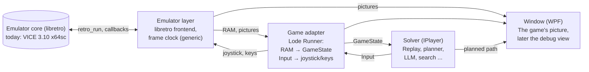

# C64 Lode Runner Auto-Player: Plan

A standalone C# program that plays Commodore 64 games. The emulator runs inside the program as a plug-in core with a standard interface (D2); the core we use is VICE's C64 emulator. The first target is **Lode Runner**.

This is the overview: status, decisions, architecture, milestones, open questions and session log. Each milestone that has started has its own document in [milestones/](milestones/) with its steps and notes. Facts about the game live in [lode-runner.md](lode-runner.md).

---

## Status

**Current milestone:** M1 (connect C# to the emulator), see [M1-connect-to-the-emulator.md](milestones/M1-connect-to-the-emulator.md)
**Last updated:** 2026-11-15

---

## Environment

| What | Where | Notes |
| --- | --- | --- |
| Emulator core | `C:\Tools\C64\libretro\vice_x64sc_libretro.dll` | The libretro core the bot runs (D2): VICE 3.10's cycle-exact C64 emulator (x64sc). Downloaded 2026-11-15 from the libretro build server (`https://buildbot.libretro.com/nightly/windows/x86_64/latest/`); reports "VICE x64sc 3.10 76cde0b". Keeps its own files in `system\` and `saves\` next to the DLL. |
| VICE 3.10 | `C:\Tools\C64\VICE-3.10` | The VICE program, now for exploring: its monitor and debugger. Use `bin\x64sc.exe`. `bin\c1541.exe` lists and extracts disk images. The manual is `doc\vice.pdf`. |
| Lode Runner disk | `C:\Emulation\ROMs\C64\Lode Runner.d64` | Holds three versions of the game; we use version A. See [lode-runner.md](lode-runner.md). |

## Decisions

| # | Decision | Reason |
| --- | ---------- | -------- |
| D1 | Language: C# / .NET | Owner's choice. |
| D2 | Run the **emulator inside our program as a libretro core**: a DLL with a standard interface, which a host program runs one frame per call. The core we use is **VICE 3.10's x64sc** (`vice_x64sc_libretro.dll`), a cycle-exact C64 emulator. *(Changed 2026-11-15: was talking to the VICE program through its binary monitor protocol.)* | With the core in our program, the emulator runs on our own steady clock, RAM is read directly, input lands on exact frames (exact replays for M3), snapshots are taken in memory (fast search for M6), and every picture comes to us (the window, the debug view and the D3 fallback). The program depends on the libretro interface, not on one emulator: another C64 core could plug in the same way, with only its core options to change. The VICE program's binary monitor didn't work out: it's built as a debugger, and every visit upsets the emulator's speed regulation and sound (M1 S6). The trial in M1 (T1–T6) proved the core works. |
| D3 | Read game state from **C64 RAM**. Template matching on the framebuffer is the fallback. | RAM gives exact data with nothing to misread. C64 output is pixel-exact and Lode Runner tiles sit on a fixed 28×16 grid, so the fallback would also be reliable. |
| D4 | The bot plays **at real-time speed and never holds the game up**. The emulator runs one frame every 1/50.125 s on our own frame clock, like a real PAL C64. The bot sees the state after every frame and has to decide in time, like a human; if it's late, the game goes on without waiting. The same loop has other rules for other jobs: one frame per key press (debugging) or flat out (testing, search). *(Changed 2026-11-14, twice: from lockstep to short visits to a free-running VICE, then to the bot pacing VICE through checkpoints. Changed again 2026-11-15, with D2.)* | Owner's choice: a human with a joystick doesn't slow the game down, and the bot shouldn't either. Talking to the VICE program over its binary monitor, this needed workarounds (M1 S6). With the core in our program (D2) it doesn't: T5 measured 100.0% speed, frames 19.93–19.97 ms apart, and 11% of one CPU core. |
| D5 | Three layers: emulator, game adapter, solver (behind an `IPlayer` interface) | The emulator layer can be reused for other games and other emulator cores, and each solver idea is just another `IPlayer` implementation. |
| D6 | Use **version A** (`loderunner+3m/pw`). During development, answer the trainer with **Y to unlimited lives and N to invincibility** (C= level skip is always on); the bot's real runs answer N/N. *(Changed 2026-11-15: was invincibility on too.)* | Clean display, unlike version C. The trainer makes testing easier: unlimited lives means the bot can keep trying a level, and any level can be reached quickly. Invincibility would let the planner be tested without guards, but it makes the demo get stuck, and then SPACE no longer starts the game (M1 T7). Owner's choice to leave it off for now; a snapshot taken after the menu (M1 T8) may bring it back. |
| D7 | Target **.NET 10** | The only SDK installed (10.0.402), and the current long-term-support release. |
| D8 | Write **our own libretro frontend** (`C64Bot.Libretro`) instead of using RetroArch or a frontend library. *(Changed 2026-11-15: was our own binary monitor client, which stays in `C64Bot.ViceMonitor` for now.)* | A frontend needs only a few functions and callbacks (T2–T6 used about fifteen), and the bot needs full control of the loop. RetroArch keeps its own pace and menus, and can't step or run flat out on request. |
| D9 | **Repository layout:** the solution lives in `C64Bot/`, documentation in `docs/`, and `CLAUDE.md` in `.claude/`. See Repository layout below. | Owner's preference: the solution root is not the repo root, and documentation doesn't live in the solution. The repo root holds only repo-wide files. |
| D10 | **One document per milestone** in `docs/milestones/`, created when the milestone starts. This file stays the overview. Game facts go in `docs/lode-runner.md`. | One plan file was getting long, and each milestone adds its own step list. Decisions and the session log stay here only, so they can't drift apart across files. |
| D11 | **WPF** for the game window and, later, the debug view | Owner's choice (2026-11-15). Built into .NET on Windows. `WriteableBitmap` shows 50 pictures a second easily, and drawing on top of the picture is simple. The project is Windows-only anyway (the frame clock uses a Windows timer). |

## Architecture



- `IPlayer.Decide(GameState) -> Input` (exact shape to be settled in M3/M4).
- The loop around the core runs one frame at a time and decides when the next one is due (D4): **in real time** (normal play; the solver must decide within its time budget), **on a key press** (debugging) or **flat out** (testing, search). Solvers don't know which mode they run in.
- The emulation and the window run on separate threads, so the window never holds up the game.
- A RAM-compare tool (diff memory between frames) is part of the emulator tooling, for finding game data in this game and future ones. RAM is read directly from the core, so comparing it every frame costs next to nothing.

### Repository layout

```text
c64bot/                             repo root: only repo-wide files
├── .claude/
│   ├── CLAUDE.md                   guide for Claude sessions (committed)
│   └── settings.local.json         personal Claude Code settings (ignored by Git)
├── .gitignore
├── docs/
│   ├── PLAN.md                     this file: the overview
│   ├── lode-runner.md              game reference: versions, notes, RAM map
│   └── milestones/                 one document per started milestone
└── C64Bot/                         solution root
    ├── C64Bot.slnx
    ├── Directory.Build.props       shared build settings for every project
    ├── src/
    │   ├── C64Bot.App/             WPF app that runs the bot (with a console for log lines)
    │   ├── C64Bot.Libretro/        emulator layer: libretro frontend and frame clock
    │   └── C64Bot.ViceMonitor/     binary monitor client for the VICE program (M1 part 1)
    └── tests/
        └── C64Bot.ViceMonitor.Tests/
```

Run .NET commands from the repo root with the folder name (`dotnet test C64Bot`), or from inside `C64Bot/` without it.

## Milestones

| # | Milestone | Status | Document |
| --- | --- | --- | --- |
| M0 | Project setup | Done | [M0-project-setup.md](milestones/M0-project-setup.md) |
| M1 | Connect C# to the emulator | In progress | [M1-connect-to-the-emulator.md](milestones/M1-connect-to-the-emulator.md) |
| M2 | Find Lode Runner's data in RAM | Not started | |
| M3 | Snapshot and replay (solver idea 1) | Not started | |
| M4 | Planner for levels without guards (solver idea 2) | Not started | |
| M5 | Guards | Not started | |
| M6 | Experiments | Not started | |

Rough scope of the milestones that haven't started yet. Each list moves into its own document when the milestone starts.

### M2: Find Lode Runner's data in RAM

- Build the RAM-compare tool
- Level grid (28×16) and tile codes
- Player position, including position within a tile
- Guard positions and states
- Gold remaining, lives, level number
- Hole/dig state and refill timers
- Find out how the C64 version maps digging (fire button plus direction, or keys)
- Record findings in the RAM map in [lode-runner.md](lode-runner.md)

### M3: Snapshot and replay (solver idea 1)

- Record inputs per frame while a human plays (in our window, M1 T10)
- Replay them from the same snapshot and confirm the result is identical

### M4: Planner for levels without guards (solver idea 2)

- Model the level as a graph using the movement rules (walk, climb, rope, fall, dig and drop)
- BFS/A* to each piece of gold, then to the exit ladder
- Debug view showing the grid and the planned path
- Test on real levels with the trainer's invincibility on, using C= to skip to the level under test

### M5: Guards

- Avoid guards
- Trap guards in holes, taking refill timing into account

### M6: Experiments

- LLM as strategist on top of the planner. In real time an LLM is too slow to steer, so it would set goals now and then while the planner does the moving.
- Snapshot search: use the emulator itself as the simulator (try moves, check the result, restore)
- Reinforcement learning (unlikely to pay off: rewards are rare and the game needs planning)

## Open questions

- Why aren't runs exactly repeatable? Two runs with the same inputs on the same frames ended with 63 bytes of RAM different (M1 T7). M3's replays need runs that repeat exactly, so find out what in the core changes from run to run (the time of day, a random seed, the disk drive?) and whether a core option or a snapshot fixes it.
- Does the trainer change any game code or RAM that the bot relies on? Check by comparing RAM with the trainer on and off once the RAM map exists.
- How should the bot get past the trainer menu: type the answers, or always start from a snapshot taken after the menu? Typing works (M1 T4), but loading and the menu take 2,532 frames, so a snapshot would be quicker. Decide in M1 T8.
- What happens to `C64Bot.ViceMonitor` (the binary monitor client) once M2 is done: keep it as a tool for exploring in the VICE program, or remove it?
- How does the C64 version handle digging input?
- Where do guards respawn, and is it random? (This affects whether replays stay deterministic.)

## Session log

- **2026-11-14:** Talked through the approach (binary monitor, RAM reading, three solver ideas plus snapshot search). Created this plan. Found VICE 3.10 and a Lode Runner disk with three versions on it (A, B, C). Version C runs but has stray white pixels on the status line. Version A has a trainer menu (unlimited lives, invincibility, C= skips levels) and a clean status line, so we chose version A (D6). Chose .NET 10 (D7) and our own binary monitor client (D8). Planned the solution skeleton as steps S1–S5 and did S1–S3. Then restructured the repo so the solution lives in `C64Bot/` and the docs in `docs/` (D9). Did S4 and S5, which completes M0. Split the plan into this overview, one document per milestone and a Lode Runner reference (D10). Broke M1 into steps, based on chapter 13 of the VICE manual. Changed D4: the bot plays in real time, and lockstep is only a debugging tool. Reordered M1 to test the risky parts (the cost of a freeze, joystick input) early. Next: M1 S1 (encode commands).
- **2026-11-14 (later):** M1 S1–S5: a binary monitor client that encodes commands, decodes responses and events, pings, resumes, and reads and writes memory, all checked against a running VICE. S6 (the real-time loop) found that short visits to a running VICE make the game run too fast, up to 168%, measured with the jiffy clock. VICE's source showed why, and that no setting changes it. Pacing VICE ourselves through a checkpoint on the game's interrupt routine gave 100%, and D4 was changed to that. Looked at alternatives, and found the VICE 3.10 libretro core.
- **2026-11-15:** Tried the libretro core on the branch `try-libretro-core` (M1 T1–T6): our program loads the core, runs Lode Runner from the real disk, reads RAM directly, presses keys through the trainer menu, runs at exactly 100% on a high-resolution frame clock, and shows the picture in a WPF window. It looked smooth. Changed D2, D4 and D8 to this, and added D11 (WPF). Renamed things to match: the repository is now `c64bot`, M1 is "Connect C# to the emulator", and the monitor client is `C64Bot.ViceMonitor`. Merged the branch into `main`. Then M1 T7 (joystick): the frontend plugs a RetroPad into the first port, and the C64 reads the right bits at `$DC00`. The game got in the way: SPACE, not fire, starts it from the demo, and the trainer's invincibility makes the demo get stuck, so D6 now leaves invincibility off. Found that runs aren't exactly repeatable (new open question). Next: M1 T8 (snapshots).
