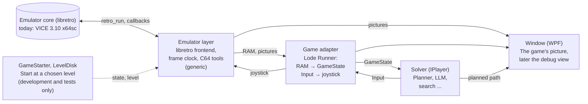

# C64 Lode Runner Auto-Player: Plan

A standalone C# program that plays Commodore 64 games. The emulator runs inside the program as a plug-in core with a standard interface (D2); the core we use is VICE's C64 emulator. The first target is **Lode Runner**.

This is the overview: status, decisions, architecture, milestones, open questions and session log. Each milestone that has started has its own document in [milestones/](milestones/) with its steps and notes. Facts about the game live in [lode-runner.md](lode-runner.md).

---

## Status

**Current milestone:** M4 (planner for levels without guards), started 2026-11-16: P1 (levels with any changes) done; P1b (clean-up of the structure) done; P2 (movement rules) done; P3 (the planner, with digging) under way, step 1 of 3 done, see [M4-planner-without-guards.md](milestones/M4-planner-without-guards.md). M3 was dropped and M2 finished, both on 2026-11-16.
**Last updated:** 2026-11-26

---

## Environment

| What | Where | Notes |
| --- | --- | --- |
| Emulator core | `C:\Tools\C64\libretro\vice_x64sc_libretro.dll` | The libretro core the bot runs (D2): VICE 3.10's cycle-exact C64 emulator (x64sc). Downloaded 2026-11-15 from the libretro build server (`https://buildbot.libretro.com/nightly/windows/x86_64/latest/`); reports "VICE x64sc 3.10 76cde0b". 4,461,568 bytes, SHA-256 `E23D6F0D282F20329717674EEAE023B1897AFBB4E2AB9A4398D49697A2A7442B`. It's a nightly build, so a new download is a different emulator: compare the checksum before replacing it. The app keeps the core's own files in `system\` and `saves\` next to the DLL. |
| VICE 3.10 | `C:\Tools\C64\VICE-3.10` | The VICE program, now for exploring: its monitor and debugger. Use `bin\x64sc.exe`. `bin\c1541.exe` lists and extracts disk images. The manual is `doc\vice.pdf`. |
| Lode Runner disk | `C:\Emulation\ROMs\C64\Lode Runner.d64` | Holds three versions of the game; we use version A. See [lode-runner.md](lode-runner.md). |

## Decisions

| # | Decision | Reason |
| --- | ---------- | -------- |
| D1 | Language: C# / .NET | Owner's choice. |
| D2 | Run the **emulator inside our program as a libretro core**: a DLL with a standard interface, which a host program runs one frame per call. The core we use is **VICE 3.10's x64sc** (`vice_x64sc_libretro.dll`), a cycle-exact C64 emulator. *(Changed 2026-11-15: was talking to the VICE program through its binary monitor protocol.)* | With the core in our program, the emulator runs on our own steady clock, RAM is read directly, input lands on exact frames (joystick-only runs from a state repeat exactly), snapshots are taken in memory (fast search for M6), and every picture comes to us (the window, the debug view and the D3 fallback). The program depends on the libretro interface, not on one emulator: another C64 core could plug in the same way, with only its core options to change. The VICE program's binary monitor didn't work out: it's built as a debugger, and every visit upsets the emulator's speed regulation and sound (M1 part 1). The trial in M1 (T1–T6) proved the core works. |
| D3 | Read game state from **C64 RAM**. Template matching on the framebuffer is the fallback. | RAM gives exact data with nothing to misread. C64 output is pixel-exact and Lode Runner's levels are a fixed grid of tiles (28×16, confirmed for the C64 in M2 F7), so the fallback would also be reliable. M2 found all the data the bot needs in RAM, read into `GameState`. |
| D4 | The bot plays **at real-time speed and never holds the game up**. The emulator runs one frame every 1/50.125 s on our own frame clock, like a real PAL C64. The bot sees the state after every frame and has to decide in time, like a human; if it's late, the game goes on without waiting. The same loop has other rules for other jobs: one frame per key press (debugging) or flat out (testing, search). *(Changed three times on 2026-11-14 and 2026-11-15, while the emulator was still the VICE program; this form came with D2.)* | Owner's choice: a human with a joystick doesn't slow the game down, and the bot shouldn't either. Talking to the VICE program over its binary monitor, this needed workarounds (M1 part 1). With the core in our program (D2) it doesn't: T5 measured 100.0% speed, frames 19.93–19.97 ms apart, and 11% of one CPU core. |
| D5 | Three layers: emulator, game adapter, solver (behind an `IPlayer` interface) | The emulator layer can be reused for other games and other emulator cores, and each solver idea is just another `IPlayer` implementation. |
| D6 | Use **version A** (`loderunner+3m/pw`). During development, answer the trainer with **Y to unlimited lives and N to invincibility**; the bot's real runs answer N/N. **Invincibility is never used.** The trainer's **level skip (C=)**, which is always on, **isn't used either**: `GameStarter` starts a new game at the level wanted (D13). *(Changed 2026-11-15: was invincibility on too. Changed 2026-11-16: C= was how to reach a level.)* | Clean display, unlike version C. Unlimited lives means the bot can keep trying a level. Invincibility makes the demo get stuck, and then SPACE no longer starts the game (M1 T7). It would also let the bot ignore guards, which isn't the game; owner's choice to drop it for good. C= takes about a second per level skipped and adds a life and 1,500 points each time, while `GameStarter` reaches any level in about a second, with a new game's lives and score; owner's choice to drop C= (2026-11-16). |
| D7 | Target **.NET 10** | The only SDK installed (10.0.402), and the current long-term-support release. |
| D8 | Write **our own libretro frontend** (`C64Bot.Libretro`) instead of using RetroArch or a frontend library. *(Changed 2026-11-15: was our own binary monitor client for the VICE program, `C64Bot.ViceMonitor`, which was removed on 2026-11-16 after M2, unused; it's in Git history.)* | A frontend needs only a few functions and callbacks (20 functions and 7 callbacks so far), and the bot needs full control of the loop. RetroArch keeps its own pace and menus, and can't step or run flat out on request. |
| D9 | **Repository layout:** the solution lives in `C64Bot/`, documentation in `docs/`, and `CLAUDE.md` in `.claude/`. See Repository layout below. | Owner's preference: the solution root is not the repo root, and documentation doesn't live in the solution. The repo root holds only repo-wide files. |
| D10 | **One document per milestone** in `docs/milestones/`, created when the milestone starts. This file stays the overview. Game facts go in `docs/lode-runner.md`. | One plan file was getting long, and each milestone adds its own step list. Decisions and the session log stay here only, so they can't drift apart across files. |
| D11 | **WPF** for the game window and, later, the debug view | Owner's choice (2026-11-15). Built into .NET on Windows. `WriteableBitmap` shows 50 pictures a second easily, and drawing on top of the picture is simple. The project is Windows-only anyway (the frame clock uses a Windows timer). |
| D12 | **Generic code goes in `C64Bot.Libretro`, Lode Runner code in `C64Bot.LodeRunner`** (the game adapter of D5). Tools that work for any game, like the RAM-compare tool, are generic. | Owner's choice (2026-11-15). Keeps the emulator layer reusable for other games, as D5 intends. |
| D13 | **In development and tests, `GameStarter` writes the game's RAM when it starts a new game**, and nothing else writes it: the level number (`$1310`, `$1305`), the level's data (`$1000`–`$10DF`) and the number of the level held there (`$133B`). **The finished bot writes nothing (D17).** That's a rule we follow: the code doesn't enforce it. The bot only reads RAM (D3). *(Changed 2026-11-24: was the level number only.)* | Owner's choice (2026-11-15, widened 2026-11-24). Any level in about a second, with the lives and score of a new game, where skipping with C= takes about a second per level and adds a life and 1,500 points each time. The level's data lets the bot learn on levels without guards, or made up for a test. The alternative, a changed copy of the disk, still loads every level from disk, which is slower and not repeatable. The code doesn't stop a changed level in a real run: nobody changes a level by accident, and unlimited lives, which it would have had to go by, doesn't mean development (owner's call). Writing during play would change the game the bot is meant to play. |
| D14 | **Read RAM after every frame, and take each thing from where it's always complete** (M2 F6): the level from the grid as built (`$0A00`), the guards from their tables, the player from `$03`–`$08`, `$54` and `$1314`–`$1316`; skip a frame that ends while the game is setting up the level, moving the player or closing holes (`$01FA` tells). *(Changed 2026-11-25: the player's tile in the grid didn't tell when a pass was half done.)* See "Reading RAM" in [lode-runner.md](lode-runner.md). | Owner's choice (2026-11-15). Most frames end halfway through one of the game's passes, but the game's tables are written in one go, so only the guard being moved is behind, by one move (33 ms). The other options were reading only when the CPU is in the main loop's wait (needs the VICE core's save format, and loses about 60% of the frames) and patching the game to flag the end of a pass (changes the game, against D17). |
| D15 | **Loading a state starts with no input at all**, like booting straight into the saved moment: `LibretroCore.LoadState` lets go of every button and key, and the first frame after it runs with no input; input given after the load counts from the frame after that. | Owner's choice (2026-11-16). The VICE core passes input on to the C64 only when it differs from the last values it was given, and those aren't part of a state (read in its source, see M1's notes), so input held across a load could get lost, or a key let go of could still be down when the next one arrives. Starting every load from nothing needs no rules for callers, and saving still works at any moment, mid-move included. Also considered: forbidding held input when saving or loading (a rule for every caller, and no saving mid-move), and carrying the held buttons along with each state (wrong with this core, which doesn't bring the joystick back from a state). |
| D16 | **Loading changed data into a game has three separate parts:** where the data comes from (`DiskImage`, or made up), what is changed (an immutable class for the game's own data, with changes as chained methods; for Lode Runner `Level`, the same class as for the running game's level), and how it gets into the game (the core's own `LoadState` and `WriteSystemRam`, which work for any game). *(Changed 2026-11-24: the last part was two classes, `RamPatch` and `StartPoint`, which only passed calls on to the core.)* No `IGame` or `ILevel` interface until a second game shows what games have in common. | Owner's choice (2026-11-24): any game's data should load with any change, without the code that starts the game knowing about the changes. Reading disks and putting data into RAM are generic, the data classes belong to their game (D12). |
| D17 | **The finished bot plays the game as it is.** The game is loaded the regular way, from the disk, and runs by itself at its own speed (D4), just as it would without a bot; nothing in it is changed or prepared. The bot hooks into that running game: after every frame it reads RAM, as a human looks at the screen, and it moves the joystick. Unhook it and the game carries on. Changed levels, starting at a chosen level (`GameStarter`), going back to a save state, running flat out and unlimited lives are only for development and tests. | Owner's decision (2026-11-24), "extremely important": the point of the project is a bot that plays the real, running game. **No other decision may weaken this.** It's about what the finished bot does: the code isn't structured to enforce it (owner's call). |
| D18 | **The movement rules are the game's own, one pass at a time** (a pass is one round of the game's main loop, about 30 a second): `GameState.Next(joystick)` gives the state after the next pass, with the player, digging, holes, gold, exit ladders, death and completion. Everything else is built on it: moves from tile to tile, routes, times, and later guards (M5) and search (M6). | Owner's call (2026-11-25): movement is foundational and has to be exactly right. The first plan, moves from tile to tile, left out what the game does: a tile takes five passes and the joystick is read in each, so he can turn around halfway, and whether he gets over a hole in time is a matter of exact passes. Holes change where he can go, so digging is in the rules from the start. Raced against the running game over 1.1 million passes without a difference (M4 notes). |
| D19 | **The planner digs from the start, and plans the whole level before the first move**, from moves worked out with the game's own rules (`Move.AllFrom`, built on `Next`, D18). It isn't taught any tricks: it tries every move, digs included, and the rules decide what works, such as the one order in which a pit can be dug. | Owner's call (2026-11-26): many levels have gold in pockets that only digging reaches, so a planner without digging would only manage the easy ones (digging was P6, and moved into P3). The game waits for the first move, and without guards nothing happens that the planner can't see coming, so the plan can be made in full beforehand and holds to the end. No level needs guards: a guard is only trapped in a hole the player dug, which was a brick he could already walk on (owner's point). |

## Architecture



- `IPlayer.Decide(GameState) -> Input` (exact shape to be settled in M4). A player gets the game state and answers with input; it isn't given the emulator.
- The loop around the core runs one frame at a time and decides when the next one is due (D4): **in real time** (normal play; the solver must decide within its time budget), **on a key press** (debugging) or **flat out** (testing, search). Solvers don't know which mode they run in.
- The emulation and the window run on separate threads, so the window never holds up the game. For the same reason the solver can't run on the emulation thread (D4): it gets the state after each frame, and its input is used from the next frame on. The exact shape comes with `IPlayer`.
- A RAM-compare tool (diff memory between frames) is part of the emulator tooling, for finding game data in this game and future ones. RAM is read directly from the core, so comparing it every frame costs next to nothing.

### Repository layout

```text
c64bot/                             repo root: only repo-wide files
├── .claude/
│   ├── CLAUDE.md                   guide for Claude sessions (committed)
│   └── settings.local.json         personal Claude Code settings (ignored by Git)
├── .gitignore
├── docs/
│   ├── PLAN.md                     this file: the overview
│   ├── lode-runner.md              game reference: versions, notes, RAM map
│   └── milestones/                 one document per started milestone
└── C64Bot/                         solution root
    ├── C64Bot.slnx
    ├── Directory.Build.props       shared build settings for every project
    ├── src/
    │   ├── C64Bot.App/             WPF app: Lode Runner in a window, a console for log lines and tools
    │   ├── C64Bot.Libretro/        emulator layer: libretro frontend, C64 core setup, frame clock, disk images, RAM-compare tool
    │   └── C64Bot.LodeRunner/      game adapter for Lode Runner: starts the game, reads it from RAM, levels from the disk or made up (D12)
    └── tests/
        ├── C64Bot.Libretro.Tests/  some need the core DLL and the Lode Runner disk, and are skipped without them
        └── C64Bot.LodeRunner.Tests/ the same
```

Run .NET commands from the repo root with the folder name (`dotnet test C64Bot`), or from inside `C64Bot/` without it.

## Milestones

| # | Milestone | Status | Document |
| --- | --- | --- | --- |
| M0 | Project setup | Done | [M0-project-setup.md](milestones/M0-project-setup.md) |
| M1 | Connect C# to the emulator | Done | [M1-connect-to-the-emulator.md](milestones/M1-connect-to-the-emulator.md) |
| M2 | Find Lode Runner's data in RAM | Done | [M2-find-ram-data.md](milestones/M2-find-ram-data.md) |
| M3 | Snapshot and replay (solver idea 1) | Dropped 2026-11-16 (owner's call): replaying a human's moves isn't the bot playing | |
| M4 | Planner for levels without guards (solver idea 2) | Started | [M4-planner-without-guards.md](milestones/M4-planner-without-guards.md) |
| M5 | Guards | Not started | |
| M6 | Experiments | Not started | |

Rough scope of the milestones that haven't started yet. Each list moves into its own document when the milestone starts.

### M5: Guards

- Avoid guards
- Trap guards in holes, taking refill timing into account
- Read the guards' movement code in the disassembly to understand how they chase the player (the owner's idea, 2026-11-24)

### M6: Experiments

- LLM as strategist on top of the planner. In real time an LLM is too slow to steer, so it would set goals now and then while the planner does the moving.
- Snapshot search: use the emulator itself as the simulator (try moves, check the result, restore). Only in development, or in a second emulator beside the game being played, which is never taken back (D17)
- Reinforcement learning (unlikely to pay off: rewards are rare and the game needs planning)

## Open questions

None at the moment.

## Session log

- **2026-11-14:** Talked through the approach (binary monitor, RAM reading, three solver ideas plus snapshot search). Created this plan. Found VICE 3.10 and a Lode Runner disk with three versions on it (A, B, C). Version C runs but has stray white pixels on the status line. Version A has a trainer menu (unlimited lives, invincibility, C= skips levels) and a clean status line, so we chose version A (D6). Chose .NET 10 (D7) and our own binary monitor client (D8). Planned the solution skeleton as steps S1–S5 and did S1–S3. Then restructured the repo so the solution lives in `C64Bot/` and the docs in `docs/` (D9). Did S4 and S5, which completes M0. Split the plan into this overview, one document per milestone and a Lode Runner reference (D10). Broke M1 into steps, based on chapter 13 of the VICE manual. Changed D4: the bot plays in real time, and lockstep is only a debugging tool. Reordered M1 to test the risky parts (the cost of a freeze, joystick input) early. Next: M1 S1 (encode commands).
- **2026-11-14 (later):** M1 S1–S5: a binary monitor client that encodes commands, decodes responses and events, pings, resumes, and reads and writes memory, all checked against a running VICE. S6 (the real-time loop) found that short visits to a running VICE make the game run too fast, up to 168%, measured with the jiffy clock. VICE's source showed why, and that no setting changes it. Pacing VICE ourselves through a checkpoint on the game's interrupt routine gave 100%, and D4 was changed to that. Looked at alternatives, and found the VICE 3.10 libretro core.
- **2026-11-15:** Tried the libretro core on the branch `try-libretro-core` (M1 T1–T6): our program loads the core, runs Lode Runner from the real disk, reads RAM directly, presses keys through the trainer menu, runs at exactly 100% on a high-resolution frame clock, and shows the picture in a WPF window. It looked smooth. Changed D2, D4 and D8 to this, and added D11 (WPF). Renamed things to match: the repository is now `c64bot`, M1 is "Connect C# to the emulator", and the monitor client is `C64Bot.ViceMonitor`. Merged the branch into `main`. Then M1 T7 (joystick): the frontend plugs a RetroPad into the first port, and the C64 reads the right bits at `$DC00`. The game got in the way: SPACE, not fire, starts it from the demo, and the trainer's invincibility makes the demo get stuck, so D6 now leaves invincibility off. Found that runs aren't exactly repeatable (new open question). Dropped invincibility for good (D6). Reviewed all code and documents: fixed the documents, tidied up `LibretroCore` (R1) and added `C64Bot.Libretro.Tests` (R3); `Program.cs` stays as it is for now. Next: M1 T8 (snapshots).
- **2026-11-15 (later):** M1 T8: `LibretroCore.SaveState` and `LoadState` save and load the whole machine in memory (about 190 KB), with tests; in the app, T saves a state and L loads it, and the demo jumped back as it should. The fixed key presses from T7 are gone from the app. Looked into why runs aren't repeatable: loading a state is complete, but VICE delays every key press by a random amount, and its random number generator isn't in the state. The bot doesn't need exact replays, so we stopped there; M3 can check joystick-only replays if it wants them. The trainer-menu question can wait. Moved T9 (debug mode) to M4, where there's a bot to step through; until then VICE's monitor is the tool for looking at the game. Next: M1 T10 (play in the window).
- **2026-11-15 (later still):** M1 T10: the window's keyboard reaches the game. The arrow keys and Right Ctrl are the joystick, the other keys go to the C64's keyboard, through a queue to the emulation thread. The owner played level 1 in our window: digging works, also while running, and Left Ctrl (C=) skips to the next level. Sound (T11) is left for later, so M1 is done. Next: start M2 (find Lode Runner's data in RAM) with its own document.
- **2026-11-15 (M2):** Started M2 and agreed its steps F1–F11. Found a reverse-engineered source of the C64 original (Piddewitt/Loderunner), which turned M2 from searching into confirming. F1: the RAM-compare tool (`RamImage`, `PrgFile`; R and D in the app's console). F2: version A is the original program apart from the trainer's three changes, so the source's addresses apply; wrote its RAM map into `lode-runner.md`. F3 (a per-frame trace) dropped. F4: the new `C64Bot.LodeRunner` (D12) reads the game's phase; "level complete" dropped as a phase. F5: `GameStarter` gets to a new game flat out in about 5 s and starts any level in about 1 s by writing the level number (D13). F6: measured where frames end (55–62% inside the game's update) and chose to read each thing from where it's always complete instead of fixing it (D14).
- **2026-11-16 (M2):** F7–F10 built `GameState` from `Level`, `Player`, `Guard` and `Hole`, with the counters, each checked headless against the core's pictures, which Claude now does itself instead of asking the owner to test (the owner's request). Learned on the way: holes only show in the grid as played and the hole tables; fire digs on the side of the last left or right move; a guard's death and respawn follow the source's rule; `GamePhaseReader.Update` must be called once per frame (it now has `Phase`). F11 went through the RAM map, so every entry says how it was confirmed or that the bot doesn't use it, and closed M2. Then removed `C64Bot.ViceMonitor` and its tests (owner's call): M2 used neither it nor the VICE program, so the binary monitor client from M1 part 1 is gone (D8; it's in Git history). Dropped the trainer's C= level skip from the plan as well (owner's call, D6): `GameStarter` picks the level, so M4 will test levels that way. Settled the open question about fire in the demo: fire ends the demo like SPACE, but only once the demo runs, and M1 T7 had pressed it too early; `GameStarter` now uses fire (owner's call), so a new game's first level waits for the first move instead of starting by itself. On the way found that a button held across loading a state can get lost: read the core's source to find out why (VICE only passes on changes, and its memory of the last input isn't in a state), and made every load start with no input at all (D15), with tests that fail without it. Next: M3 (snapshot and replay).
- **2026-11-16 (review):** Went over the whole project, code and documents. Measured which runs repeat exactly: joystick-only runs from a state saved once a level runs repeat byte for byte, but runs with key presses don't, and neither does loading a level from disk (M1's notes; M3's scope now says to record from a state taken after the level has loaded). Code: `Directory.Build.props` is the only place that sets the target (`net10.0-windows`); `LibretroCore` lost its picture count and size, which nothing used (each picture comes with its size), and keeps the other members nothing uses yet, since a later milestone or game may need them (owner's call); `RamMap` is in topic order (`Alive` is now `PlayerAlive`); `Player` and `Guard` share one reader for place and sprite (`Figure`); `LodeRunnerCore.Load` sets the core up for Lode Runner, for the app and the tests; the app prints the core's name and version, and lost its step tags. Documents: M1's part 1 is summed up in a few lines, M2's steps and notes say what was built and checked (the F6 table stays), `lode-runner.md` has a Play section and no duplicates, and `CLAUDE.md` says Claude runs the checks itself. R2 (split up `Program.cs`) still waits (owner's call). Next: M3 (snapshot and replay).
- **2026-11-16 (M3 dropped, M4 started):** Started M3 (snapshot and replay) and proposed its steps, then dropped it (owner's call): replaying a human's moves isn't the bot playing, and what M3 would have given is already there (save states, `GameStarter.StartLevel`) or comes free (a bot run flat out from a state repeats exactly). Started M4 (the planner) and proposed its steps P1–P7. The owner asked whether a level's guards can be removed. No level on the disk is without guards (each has 2–5), but the game builds a level's guards from the guard tiles in its data, and a level put into the game's level buffer (`$1000`, with the reload marker `$133B`) is set up from there without reading the disk. Tried headless: without the guard tiles, a level has no guards; with them, it's the same level as from the disk, starts 150 frames sooner, and runs from `StartLevel` repeat exactly. Open points for the owner: writing the level's data (D13), `IPlayer`'s shape, R2. Next: agree M4's steps and open points, then P1.
- **2026-11-24 (M4 P1):** Agreed M4's steps and settled how levels are put into the game: D13 widened to the level's data, and, at the owner's request, a design of three separate parts (D16) instead of a guard switch in `GameStarter`. The code doesn't enforce "changed levels are for development only" (owner's call). The owner settled that the finished bot plays the game as it is (D17). P1, now in five parts, is done: `DiskImage`; `RamPatch` and `StartPoint`, which `GameStarter` now uses; `LevelData` with `LevelTile`; `GameStarter.StartLevel` with a `LevelData`; and the app's `noguards` argument. A level number means the game's own level, loaded from the disk; a `LevelData` carries its own number, so the two are never given together (owner's call). A review of P1 then found the structure more complicated than needed, and that nothing in it kept the bot from the emulator (D17); agreed P1b, a clean-up in six steps that changes D12 and D16, and did steps 1 (fire and the repeat test), 2 (`RamPatch` and `StartPoint` removed), 3 (one `Level`, one `Tile`, one `StartLevel`), 4 (generic parts to `C64Bot.Libretro`) and 6 (the documents). Step 5, a project of its own for what starts levels so that the bot can't reach the emulator, was dropped (owner's call): D17 is about what the finished bot does, not a reason to structure the code around. Checking level 89 showed that a tile can have gold on a hidden ladder, so `Level` lists the hidden ladders beside the tiles. The owner's idea in `README.md` (look into how guards chase) went into M5's scope. Next: P2, the movement rules.
- **2026-11-25 (M4 P2):** Started P2. The owner pointed out that holes change the level while it's played, and asked for more thought on movement, as it's foundational: instead of moves from tile to tile, the rules are the game's own, one pass at a time (D18), with digging in them from the start. A trial of those rules raced against the running game without a difference. P2 now has five steps; step 1 is done (`Level.HiddenLadders` lists only the ladders still hidden). The owner asked whether the dig's passes are why a guard nearby can stop a dig: yes, confirmed in the running game (in `lode-runner.md`). That showed states read halfway through a pass, so step 2, the player's last direction and the dig's progress in `GameState`, also finds out when a pass is half done and skips such frames (D14). With that, the rules matched every state read, without any tolerance, over 563,787 passes on all 150 levels. Step 3: `state.Next(joystick)` gives the whole state after the next pass (`Pass` has the rules), raced against the running game without a difference. On the way found that `GameState` couldn't be read when a hole had closed on the player, and could be read while a level was still being set up; both fixed. Step 4: a race of about 10 seconds among the tests; the one over all 150 levels takes minutes, so it's skipped unless asked for and used with great restraint (owner's call). Step 5: the rules are written down in `lode-runner.md` ("Movement rules"), and P2 is done. Next: P3, the planner without digging.
- **2026-11-26 (M4 P3):** Agreed P3 with the owner, reworked: the planner digs from the start (D19), since many levels have gold that only digging reaches, and P6 (digging) moved into it. The owner's points on digging: no level needs guards, gold can be deeper than two bricks, a pit is dug in one order only (each layer from the far end back toward him, since he stands on the brick he'd dig next), and a layer can turn the other way. Step 1 is done: `Move.AllFrom` gives every move he can make from a state and survive, each worked out with `Next`. On the real levels it found that a hole closing under him in a fall stops him below the middle of a tile, so moves end where he's stopped, not only in the middle of a tile, and that levels 48, 73 and 150 start with him in the air, where the fall is his only move. Next: step 2, the routes.
