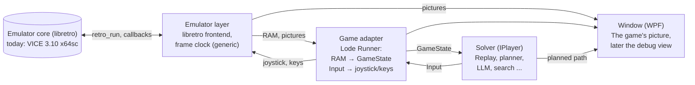

# C64 Lode Runner Auto-Player: Plan

A standalone C# program that plays Commodore 64 games. The emulator runs inside the program as a plug-in core with a standard interface (D2); the core we use is VICE's C64 emulator. The first target is **Lode Runner**.

This is the overview: status, decisions, architecture, milestones, open questions and session log. Each milestone that has started has its own document in [milestones/](milestones/) with its steps and notes. Facts about the game live in [lode-runner.md](lode-runner.md).

---

## Status

**Current milestone:** M3 (snapshot and replay), not started yet. M2 was finished on 2026-11-16, see [M2-find-ram-data.md](milestones/M2-find-ram-data.md).
**Last updated:** 2026-11-16

---

## Environment

| What | Where | Notes |
| --- | --- | --- |
| Emulator core | `C:\Tools\C64\libretro\vice_x64sc_libretro.dll` | The libretro core the bot runs (D2): VICE 3.10's cycle-exact C64 emulator (x64sc). Downloaded 2026-11-15 from the libretro build server (`https://buildbot.libretro.com/nightly/windows/x86_64/latest/`); reports "VICE x64sc 3.10 76cde0b". 4,461,568 bytes, SHA-256 `E23D6F0D282F20329717674EEAE023B1897AFBB4E2AB9A4398D49697A2A7442B`. It's a nightly build, so a new download is a different emulator: compare the checksum before replacing it. The app keeps the core's own files in `system\` and `saves\` next to the DLL. |
| VICE 3.10 | `C:\Tools\C64\VICE-3.10` | The VICE program, now for exploring: its monitor and debugger. Use `bin\x64sc.exe`. `bin\c1541.exe` lists and extracts disk images. The manual is `doc\vice.pdf`. |
| Lode Runner disk | `C:\Emulation\ROMs\C64\Lode Runner.d64` | Holds three versions of the game; we use version A. See [lode-runner.md](lode-runner.md). |

## Decisions

| # | Decision | Reason |
| --- | ---------- | -------- |
| D1 | Language: C# / .NET | Owner's choice. |
| D2 | Run the **emulator inside our program as a libretro core**: a DLL with a standard interface, which a host program runs one frame per call. The core we use is **VICE 3.10's x64sc** (`vice_x64sc_libretro.dll`), a cycle-exact C64 emulator. *(Changed 2026-11-15: was talking to the VICE program through its binary monitor protocol.)* | With the core in our program, the emulator runs on our own steady clock, RAM is read directly, input lands on exact frames (exact replays for M3), snapshots are taken in memory (fast search for M6), and every picture comes to us (the window, the debug view and the D3 fallback). The program depends on the libretro interface, not on one emulator: another C64 core could plug in the same way, with only its core options to change. The VICE program's binary monitor didn't work out: it's built as a debugger, and every visit upsets the emulator's speed regulation and sound (M1 S6). The trial in M1 (T1–T6) proved the core works. |
| D3 | Read game state from **C64 RAM**. Template matching on the framebuffer is the fallback. | RAM gives exact data with nothing to misread. C64 output is pixel-exact and Lode Runner's levels are a fixed grid of tiles (28×16, confirmed for the C64 in M2 F7), so the fallback would also be reliable. M2 found all the data the bot needs in RAM, read into `GameState`. |
| D4 | The bot plays **at real-time speed and never holds the game up**. The emulator runs one frame every 1/50.125 s on our own frame clock, like a real PAL C64. The bot sees the state after every frame and has to decide in time, like a human; if it's late, the game goes on without waiting. The same loop has other rules for other jobs: one frame per key press (debugging) or flat out (testing, search). *(Changed 2026-11-14, twice: from lockstep to short visits to a free-running VICE, then to the bot pacing VICE through checkpoints. Changed again 2026-11-15, with D2.)* | Owner's choice: a human with a joystick doesn't slow the game down, and the bot shouldn't either. Talking to the VICE program over its binary monitor, this needed workarounds (M1 S6). With the core in our program (D2) it doesn't: T5 measured 100.0% speed, frames 19.93–19.97 ms apart, and 11% of one CPU core. |
| D5 | Three layers: emulator, game adapter, solver (behind an `IPlayer` interface) | The emulator layer can be reused for other games and other emulator cores, and each solver idea is just another `IPlayer` implementation. |
| D6 | Use **version A** (`loderunner+3m/pw`). During development, answer the trainer with **Y to unlimited lives and N to invincibility** (C= level skip is always on); the bot's real runs answer N/N. **Invincibility is never used.** *(Changed 2026-11-15: was invincibility on too.)* | Clean display, unlike version C. The trainer makes testing easier: unlimited lives means the bot can keep trying a level, and any level can be reached quickly. Invincibility makes the demo get stuck, and then SPACE no longer starts the game (M1 T7). It would also let the bot ignore guards, which isn't the game; owner's choice to drop it for good. |
| D7 | Target **.NET 10** | The only SDK installed (10.0.402), and the current long-term-support release. |
| D8 | Write **our own libretro frontend** (`C64Bot.Libretro`) instead of using RetroArch or a frontend library. *(Changed 2026-11-15: was our own binary monitor client, which stays in `C64Bot.ViceMonitor` for now.)* | A frontend needs only a few functions and callbacks (20 functions and 7 callbacks so far), and the bot needs full control of the loop. RetroArch keeps its own pace and menus, and can't step or run flat out on request. |
| D9 | **Repository layout:** the solution lives in `C64Bot/`, documentation in `docs/`, and `CLAUDE.md` in `.claude/`. See Repository layout below. | Owner's preference: the solution root is not the repo root, and documentation doesn't live in the solution. The repo root holds only repo-wide files. |
| D10 | **One document per milestone** in `docs/milestones/`, created when the milestone starts. This file stays the overview. Game facts go in `docs/lode-runner.md`. | One plan file was getting long, and each milestone adds its own step list. Decisions and the session log stay here only, so they can't drift apart across files. |
| D11 | **WPF** for the game window and, later, the debug view | Owner's choice (2026-11-15). Built into .NET on Windows. `WriteableBitmap` shows 50 pictures a second easily, and drawing on top of the picture is simple. The project is Windows-only anyway (the frame clock uses a Windows timer). |
| D12 | **Generic code goes in `C64Bot.Libretro`, Lode Runner code in `C64Bot.LodeRunner`** (the game adapter of D5, created when its first code is written, M2 F4). Tools that work for any game, like the RAM-compare tool, are generic. | Owner's choice (2026-11-15). Keeps the emulator layer reusable for other games, as D5 intends. |
| D13 | **The bot writes the game's RAM only to choose the level a new game starts at**, never during play: `GameStarter` writes the level number (`$1310`, `$1305`) into a new game before it loads its level (M2 F5). Otherwise the bot only reads RAM (D3). | Owner's choice (2026-11-15). Any level in about a second, with the lives and score of a new game, where skipping with C= takes about a second per level and adds a life and 1,500 points each time. Writing during play would change the game the bot is meant to play. |
| D14 | **Read RAM after every frame, and take each thing from where it's always complete** (M2 F6): the level from the grid as built (`$0A00`), the guards from their tables, the player from `$03`–`$07`; skip a frame where the grid (`$0800`) has no player tile at the player's column and row. See "Reading RAM" in [lode-runner.md](lode-runner.md). | Owner's choice (2026-11-15). Most frames end halfway through one of the game's passes, but the game's tables are written in one go, so only the guard being moved is behind, by one move (33 ms). The other options were reading only when the CPU is in the main loop's wait (needs the VICE core's save format, and loses about 60% of the frames) and patching the game to flag the end of a pass (changes the game, against D13). |

## Architecture



- `IPlayer.Decide(GameState) -> Input` (exact shape to be settled in M3/M4).
- The loop around the core runs one frame at a time and decides when the next one is due (D4): **in real time** (normal play; the solver must decide within its time budget), **on a key press** (debugging) or **flat out** (testing, search). Solvers don't know which mode they run in.
- The emulation and the window run on separate threads, so the window never holds up the game. For the same reason the solver can't run on the emulation thread (D4): it gets the state after each frame, and its input is used from the next frame on. The exact shape comes with `IPlayer`.
- A RAM-compare tool (diff memory between frames) is part of the emulator tooling, for finding game data in this game and future ones. RAM is read directly from the core, so comparing it every frame costs next to nothing.

### Repository layout

```text
c64bot/                             repo root: only repo-wide files
├── .claude/
│   ├── CLAUDE.md                   guide for Claude sessions (committed)
│   └── settings.local.json         personal Claude Code settings (ignored by Git)
├── .gitignore
├── docs/
│   ├── PLAN.md                     this file: the overview
│   ├── lode-runner.md              game reference: versions, notes, RAM map
│   └── milestones/                 one document per started milestone
└── C64Bot/                         solution root
    ├── C64Bot.slnx
    ├── Directory.Build.props       shared build settings for every project
    ├── src/
    │   ├── C64Bot.App/             WPF app that runs the bot (with a console for log lines)
    │   ├── C64Bot.Libretro/        emulator layer: libretro frontend, frame clock, RAM-compare tool
    │   ├── C64Bot.LodeRunner/      game adapter for Lode Runner: reads the game from RAM (D12)
    │   └── C64Bot.ViceMonitor/     binary monitor client for the VICE program (M1 part 1)
    └── tests/
        ├── C64Bot.Libretro.Tests/  some need the core DLL and the Lode Runner disk, and are skipped without them
        ├── C64Bot.LodeRunner.Tests/
        └── C64Bot.ViceMonitor.Tests/
```

Run .NET commands from the repo root with the folder name (`dotnet test C64Bot`), or from inside `C64Bot/` without it.

## Milestones

| # | Milestone | Status | Document |
| --- | --- | --- | --- |
| M0 | Project setup | Done | [M0-project-setup.md](milestones/M0-project-setup.md) |
| M1 | Connect C# to the emulator | Done | [M1-connect-to-the-emulator.md](milestones/M1-connect-to-the-emulator.md) |
| M2 | Find Lode Runner's data in RAM | Done | [M2-find-ram-data.md](milestones/M2-find-ram-data.md) |
| M3 | Snapshot and replay (solver idea 1) | Not started | |
| M4 | Planner for levels without guards (solver idea 2) | Not started | |
| M5 | Guards | Not started | |
| M6 | Experiments | Not started | |

Rough scope of the milestones that haven't started yet. Each list moves into its own document when the milestone starts.

### M3: Snapshot and replay (solver idea 1)

- Record inputs per frame while a human plays (in our window, M1 T10)
- Replay them from the same snapshot. Runs with key presses can't repeat exactly, because VICE delays each key press by a random amount (M1 T8). If exact replays matter, check whether joystick-only runs repeat.

### M4: Planner for levels without guards (solver idea 2)

- Model the level as a graph using the movement rules (walk, climb, rope, fall, dig and drop)
- BFS/A* to each piece of gold, then to the exit ladder
- Debug view showing the grid and the planned path
- Debug mode (moved from M1 T9): the real-time loop with a different rule, one frame per key press in the window, and a key to switch between that and real time. Check: each press advances the game by one frame, and holding the key runs it in slow motion.
- Test on real levels with unlimited lives on, using C= to skip to the level under test (no invincibility, D6)

### M5: Guards

- Avoid guards
- Trap guards in holes, taking refill timing into account

### M6: Experiments

- LLM as strategist on top of the planner. In real time an LLM is too slow to steer, so it would set goals now and then while the planner does the moving.
- Snapshot search: use the emulator itself as the simulator (try moves, check the result, restore)
- Reinforcement learning (unlikely to pay off: rewards are rare and the game needs planning)

## Open questions

- What happens to `C64Bot.ViceMonitor` (the binary monitor client) now that M2 is done: keep it as a tool for exploring in the VICE program, or remove it? M2 didn't use it, nor the VICE program: the disassembly, headless scripts and save states did the exploring.
- The disassembly says fire ends the demo (`DemoHandler`) and starts a game from the title screen, but in M1 T7 fire at frame 1000 left the demo running. Why? Not needed for now: SPACE works.

## Session log

- **2026-11-14:** Talked through the approach (binary monitor, RAM reading, three solver ideas plus snapshot search). Created this plan. Found VICE 3.10 and a Lode Runner disk with three versions on it (A, B, C). Version C runs but has stray white pixels on the status line. Version A has a trainer menu (unlimited lives, invincibility, C= skips levels) and a clean status line, so we chose version A (D6). Chose .NET 10 (D7) and our own binary monitor client (D8). Planned the solution skeleton as steps S1–S5 and did S1–S3. Then restructured the repo so the solution lives in `C64Bot/` and the docs in `docs/` (D9). Did S4 and S5, which completes M0. Split the plan into this overview, one document per milestone and a Lode Runner reference (D10). Broke M1 into steps, based on chapter 13 of the VICE manual. Changed D4: the bot plays in real time, and lockstep is only a debugging tool. Reordered M1 to test the risky parts (the cost of a freeze, joystick input) early. Next: M1 S1 (encode commands).
- **2026-11-14 (later):** M1 S1–S5: a binary monitor client that encodes commands, decodes responses and events, pings, resumes, and reads and writes memory, all checked against a running VICE. S6 (the real-time loop) found that short visits to a running VICE make the game run too fast, up to 168%, measured with the jiffy clock. VICE's source showed why, and that no setting changes it. Pacing VICE ourselves through a checkpoint on the game's interrupt routine gave 100%, and D4 was changed to that. Looked at alternatives, and found the VICE 3.10 libretro core.
- **2026-11-15:** Tried the libretro core on the branch `try-libretro-core` (M1 T1–T6): our program loads the core, runs Lode Runner from the real disk, reads RAM directly, presses keys through the trainer menu, runs at exactly 100% on a high-resolution frame clock, and shows the picture in a WPF window. It looked smooth. Changed D2, D4 and D8 to this, and added D11 (WPF). Renamed things to match: the repository is now `c64bot`, M1 is "Connect C# to the emulator", and the monitor client is `C64Bot.ViceMonitor`. Merged the branch into `main`. Then M1 T7 (joystick): the frontend plugs a RetroPad into the first port, and the C64 reads the right bits at `$DC00`. The game got in the way: SPACE, not fire, starts it from the demo, and the trainer's invincibility makes the demo get stuck, so D6 now leaves invincibility off. Found that runs aren't exactly repeatable (new open question). Dropped invincibility for good (D6). Reviewed all code and documents: fixed the documents, tidied up `LibretroCore` (R1) and added `C64Bot.Libretro.Tests` (R3); `Program.cs` stays as it is for now. Next: M1 T8 (snapshots).
- **2026-11-15 (later):** M1 T8: `LibretroCore.SaveState` and `LoadState` save and load the whole machine in memory (about 190 KB), with tests; in the app, T saves a state and L loads it, and the demo jumped back as it should. The fixed key presses from T7 are gone from the app. Looked into why runs aren't repeatable: loading a state is complete, but VICE delays every key press by a random amount, and its random number generator isn't in the state. The bot doesn't need exact replays, so we stopped there; M3 can check joystick-only replays if it wants them. The trainer-menu question can wait. Moved T9 (debug mode) to M4, where there's a bot to step through; until then VICE's monitor is the tool for looking at the game. Next: M1 T10 (play in the window).
- **2026-11-15 (later still):** M1 T10: the window's keyboard reaches the game. The arrow keys and Right Ctrl are the joystick, the other keys go to the C64's keyboard, through a queue to the emulation thread. The owner played level 1 in our window: digging works, also while running, and Left Ctrl (C=) skips to the next level. Sound (T11) is left for later, so M1 is done. Next: start M2 (find Lode Runner's data in RAM) with its own document.
- **2026-11-15 (M2):** Started M2 and agreed its steps F1–F11. Found a reverse-engineered source of the C64 original (Piddewitt/Loderunner), which turned M2 from searching into confirming. F1: the RAM-compare tool (`RamImage`, `PrgFile`; R and D in the app's console). F2: version A is the original program apart from the trainer's three changes, so the source's addresses apply; wrote its RAM map into `lode-runner.md`. F3 (a per-frame trace) dropped. F4: the new `C64Bot.LodeRunner` (D12) reads the game's phase; "level complete" dropped as a phase. F5: `GameStarter` gets to a new game flat out in about 5 s and starts any level in about 1 s by writing the level number (D13). F6: measured where frames end (55–62% inside the game's update) and chose to read each thing from where it's always complete instead of fixing it (D14).
- **2026-11-16 (M2):** F7–F10 built `GameState` from `Level`, `Player`, `Guard` and `Hole`, with the counters, each checked headless against the core's pictures, which Claude now does itself instead of asking the owner to test (the owner's request). Learned on the way: holes only show in the grid as played and the hole tables; fire digs on the side of the last left or right move; a guard's death and respawn follow the source's rule; `GamePhaseReader.Update` must be called once per frame (it now has `Phase`). F11 went through the RAM map, so every entry says how it was confirmed or that the bot doesn't use it, and closed M2. Next: M3 (snapshot and replay); the open question about `C64Bot.ViceMonitor` is due now.
